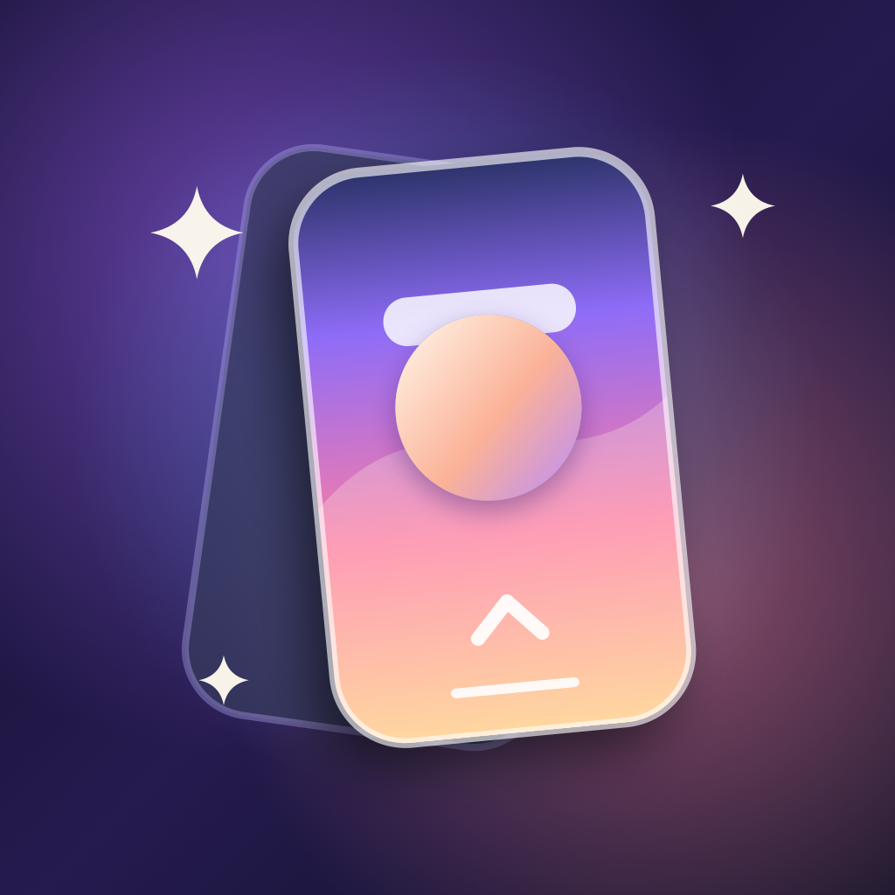
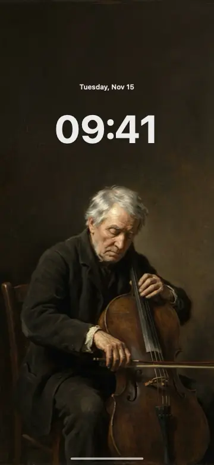
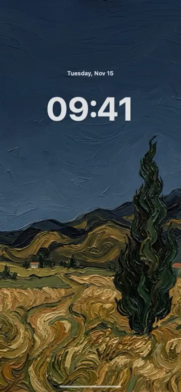
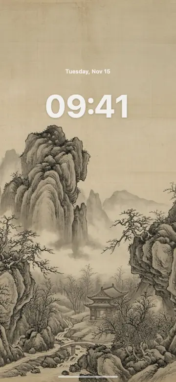
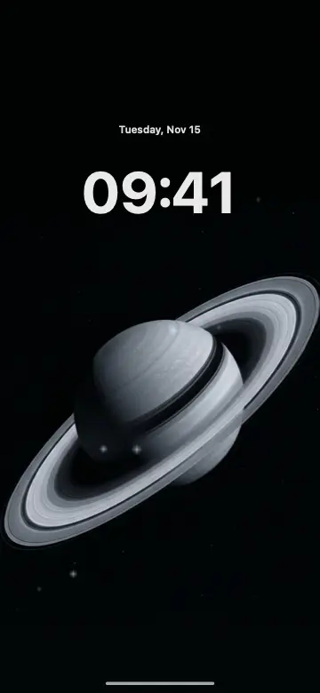
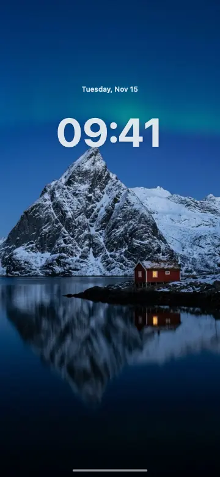

   
  
   
  <h1>Camlo · 开幕</h1>
  
<strong>让 iPhone 锁屏真正“活”起来 —— 亮屏是一幅画，上滑解锁瞬间变身</strong>

  
不用连电脑、不用越狱、也不用写代码，在手机上点一下就能换上会动、会变身、带裸眼 3D 景深的锁屏壁纸。

  

    <strong>简体中文</strong> ·
    <a href="./README_EN.md">English</a> ·
    <a href="./docs/FEATURES.md">📖 详细介绍与技术原理</a> ·
    <a href="./wallpapers/README.md">🎨 60 套大师壁纸图鉴</a>
  

  
  
  
  

   
  
   
  ▲ 官方云端部分壁纸真实动态预览（支持锁屏 120Hz 实时试穿，点击查看全部 60 套馆藏作品）

> [!WARNING]
> **系统版本重要提醒（2026-11-17）**：苹果已于 **`iOS / iPadOS 27.3 beta 2`（Build `24C5049d`）** 封堵 `worse_query` 沙盒漏洞，**免电脑直写通道最高仅支持至 `27.3 beta 1`**（`27.3 beta 2` 及以上仅支持制作并导出 `.tendies` 壁纸包）。需要免电脑直写的用户请停留在 `27.2.1 – 27.3 beta 1` 并关闭自动更新。

---

## ✨ 它可以让你的锁屏变成什么样？

- **🎬 上滑解锁，画面跟着活起来**：从相册挑 2 张图（比如 *暮色雪山 → 日照金山*、*黑白剪影 → 彩色觉醒*），每次点亮屏幕、上滑解锁都有舞台揭幕般的动态过渡。
- **📱 原生适配 iPhone Duo 内外双屏画布（Inner + Outer）**：支持单包直编外屏封面（`466×678` pt）+ 展开横屏画布（`951×669` pt）统一 `WallpaperKit` `<wallpapers>` `ParameterizedCA` 工程，工坊实时双屏切换裁切；
- **🎞️ 实况照片 & 短视频直出动态锁屏**：相册里的 Live Photo 或短视频直接做成无缝循环的动态锁屏，点亮即动，息屏自动休眠不耗电。
- **🪄 裸眼 3D · 人物挡时间 · 昼夜换装 · 漫天流光**：晃动手机有 3D 视差；一键把人物或山峰叠在 `09:41` 时间前面；白天黑夜自动换壁纸；还能叠加上流星、樱花、极光、飞雪等动态光效。
- **🏛️ 仅 ~9 MB 小体积，免费畅享 385+ 款云端壁纸**：内置 6 套获奖风光，云端免费直连 **60 套博物馆馆藏名画意境壁纸**（含 **10 套 iPhone Duo 内外双屏专享壁纸**、伦勃朗、莫奈、宋代山水等）与 300+ 款社区作品，App 内直接试穿、喜欢再下。

---

## 📲 下载与安装

支持 **iOS / iPadOS 26.0 – 27.3 beta 1**，无需越狱、无需连接电脑。

### 方式一：一键订阅软件源（推荐，支持应用内更新）

  
  
  

或复制源地址手动添加：
- **官方直连源**（兼容 SideStore / AltStore / Feather / LiveContainer）：`https://raw.githubusercontent.com/Kianuni/Camlo/main/apps.json`
- **国内加速源**：`https://ghfast.top/https://raw.githubusercontent.com/Kianuni/Camlo/main/apps.json`

### 方式二：下载 IPA 安装包

前往 **[Releases 最新版本页面](https://github.com/Kianuni/Camlo/releases/latest)** 下载 `Camlo_v1.3.0_Bilingual.ipa`，使用 SideStore / AltStore / Feather / 轻松签 ESign / Sideloadly 等工具签名安装。

> [!TIP]
> 推荐使用支持保留 `App Group` 权限的签名工具（如 SideStore / AltStore / Feather），即可解锁**手机端一键直写系统锁屏**；无此权限也依然可以完整创作、预览并导出 `.tendies` 壁纸包。

---

## 🚀 30 秒上手（只需三步）

1. 打开 **开幕 Camlo**，挑选喜欢的壁纸点 **「一键应用到锁屏」**，再按提示点 **「立即注销桌面生效」**；
2. 锁屏界面**长按空白处**，点击右下角蓝色 **`+`** 号；
3. 在 **「专为你的 iPhone 设计的墙纸」** 那一排（或滑到底部 **「收藏」**）点击添加，完成！

---

## 📚 了解更多

- **[📖 完整功能详解、技术原理与源码编译指南 →](./docs/FEATURES.md)**
- **[🎨 浏览官方 60 套馆藏级云端壁纸图鉴（含 10 套 iPhone Duo 专享 · 支持预览与直接下载）→](./wallpapers/README.md)**
- **🛠️ 同作者开源项目**：[Erosion-CN](https://github.com/Kianuni/Erosion-CN) · [AppleFlow](https://github.com/Kianuni/AppleFlow) · [WQGuard](https://github.com/Kianuni/WQGuard)
- **⚖️ 开源许可**：基于 **[GPLv3](./LICENSE)** 开源 · [致谢与参考项目](./docs/FEATURES.md#开源许可与致谢)
