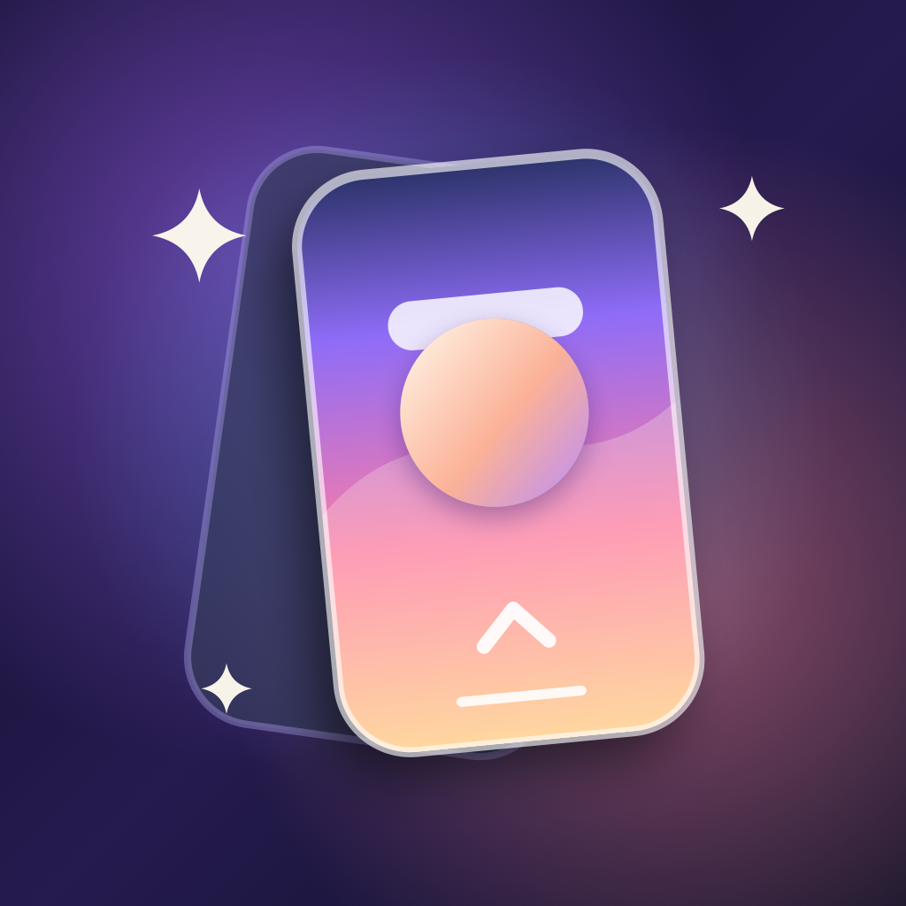
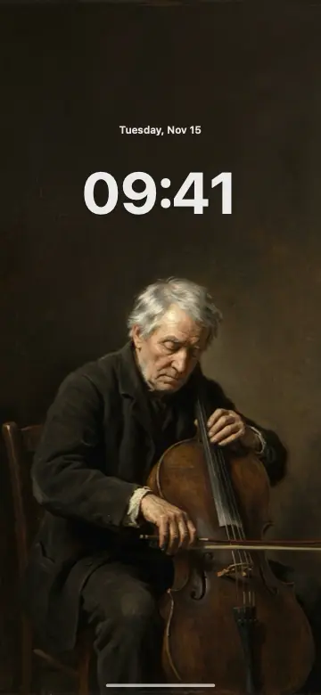
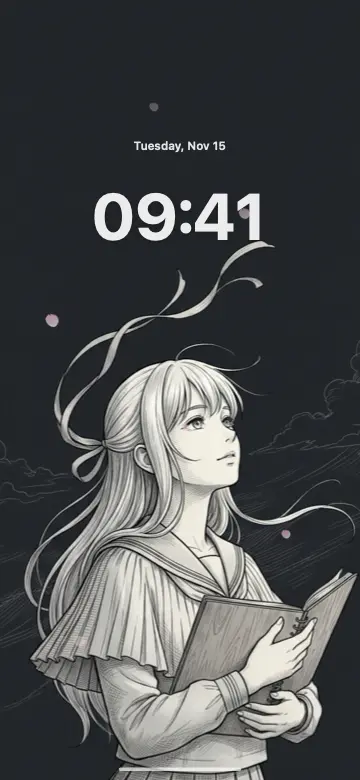
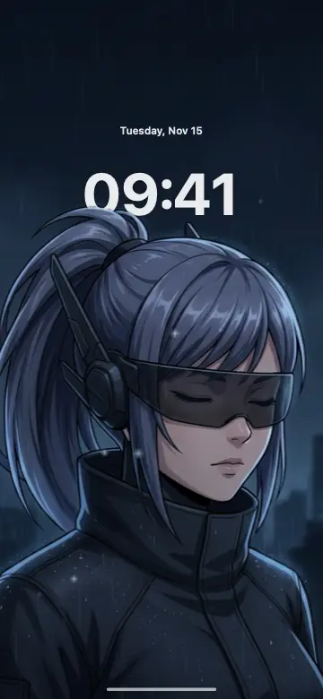
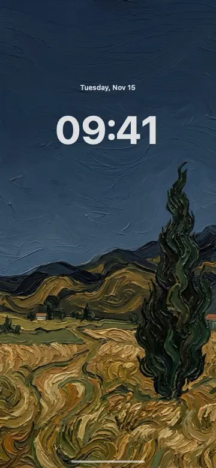
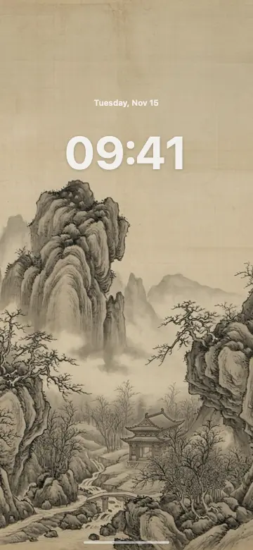
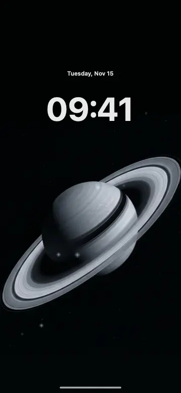

<div align="center">
  <br>
  
  <br>
  <h1>Camlo · 开幕</h1>
  <p><strong>Bring your iPhone Lock Screen to life — Wake to a still artwork, swipe to unveil its transformation.</strong></p>
  <p>No PC, no jailbreak, no code required. Craft interactive, 3D-parallax, and motion Lock Screen wallpapers and apply them right on your iPhone.</p>
  <p>
    <a href="./README.md">简体中文</a> ·
    <strong>English</strong> ·
    <a href="./docs/FEATURES_EN.md">📖 Full Feature & Tech Guide</a> ·
    <a href="./wallpapers/README.md">🎨 76 Official Cloud Packs</a>
  </p>
  
  
  
  <a href="./LICENSE"></a>
</div>

<div align="center">
  <br>
  <a href="./wallpapers/README.md">
    
    
    
    
    
    
  </a>
  <br>
  <sub>▲ Live animated previews from the zero-bloat Cloud Gallery (interactive 120Hz try-on inside Camlo — tap to browse all 76 official packs)</sub>
</div>

> [!WARNING]
> **Important Version Notice (2026-11-17)**: Apple has **patched `worse_query` in `iOS / iPadOS 27.3 beta 2` (`24C5049d`)**. On-device **Computer-Free Direct Write is supported up to `27.3 beta 1` only** (`27.3 beta 2+` can still craft and export `.tendies` packs). Stay on `27.2.1 – 27.3 beta 1` and disable automatic updates if you rely on on-device direct write.

---

## ✨ What Can Camlo Turn Your Lock Screen Into?

- **📱 Native iPhone Duo Dual-Screen Canvas (`Inner` + `Outer`)**: Compiles unified `WallpaperKit` `<wallpapers>` `ParameterizedCA` packages driving both the outer cover (`466×678` pt) and unfolded landscape inner canvas (`951×669` pt) seamlessly, plus live interactive dual-screen switching & cropping inside Studio.
- **🎬 Smooth Slide-to-Unlock Transformations**: Pick any 2 photos (e.g. *dusk mountain → alpenglow sunrise*, *monochrome → full color*) and watch your Lock Screen morph like opening a curtain with 6 expressive motion presets.
- **🎞️ Live Photos & Video Loops on Your Lock Screen**: Turn Live Photos or short clips into seamless background-safe motion wallpapers that animate smoothly when awake and pause automatically in Always-On Display.
- **🪄 Glasses-Free 3D · Clock Depth · Day/Night · Particle FX**: Tilt your iPhone for 120Hz gyroscope parallax, layer subjects in front of the `09:41` clock with 1 tap, switch Day/Night appearances automatically, and add meteors, sakura, aurora, or snowfall.
- **🏛️ Ultra-Slim ~9 MB App + 400+ Cloud Wallpapers**: Ships with 6 built-in landscape presets plus free OTA access to **76 official zero-bloat cloud packs** (**13 original 3D Gyro + Clock-Depth Anime & Graphic Poster packs**, **13 exclusive iPhone Duo Inner+Outer packs**, and **50 museum-grade Fine Art masterpieces**) alongside 300+ community themes — preview at 120Hz before downloading.

---

## 📲 Download & Install

Works on **iOS / iPadOS 26.0 – 27.3 beta 1** — no jailbreak and no PC required.

### Option A: Subscribe to the Auto-Updating Source (Recommended)

<p>
  <a href="https://altdirect.app/?url=https://raw.githubusercontent.com/Kianuni/Camlo/main/apps.json&r=sidestore"></a>
  <a href="https://altdirect.app/?url=https://raw.githubusercontent.com/Kianuni/Camlo/main/apps.json&r=altstore"></a>
  <a href="https://altdirect.app/?url=https://raw.githubusercontent.com/Kianuni/Camlo/main/apps.json&r=feather"></a>
</p>

Or add the source URL manually (SideStore / AltStore / Feather / LiveContainer / ESign):
```text
https://raw.githubusercontent.com/Kianuni/Camlo/main/apps.json
```

### Option B: Sideload the IPA Manually

Download `Camlo_v1.3.4_Bilingual.ipa` from **[Latest Releases](https://github.com/Kianuni/Camlo/releases/latest)** and install with SideStore, AltStore, Feather, ESign, or Sideloadly.

> [!TIP]
> Signing tools that preserve at least one `App Group` entitlement (such as SideStore, AltStore, or Feather) unlock **1-tap direct apply to iOS Lock Screen**; without it, creation, preview, and `.tendies` export still work 100%.

---

## 🚀 Ready in 30 Seconds (3 Steps)

1. Open **Camlo**, pick a wallpaper, tap **1-Tap Apply to Lock Screen**, then tap **Respring Now** when prompted;
2. Long-press your **Lock Screen** and tap the blue **`+`** button at the bottom right;
3. Pick it from **"Wallpaper designed for your iPhone"** (or scroll down to **Collections** on older models) and tap **Add**!

---

## 📚 Learn More

- **[📖 Full Features, Rendering Architecture & Build Guide →](./docs/FEATURES_EN.md)**
- **[🎨 Browse All 76 Official Cloud Wallpapers (13 Original 3D Anime & Graphic Poster · 13 iPhone Duo Exclusives · 50 Fine Art Masterworks) →](./wallpapers/README.md)**
- **🛠️ Related Open-Source Tools**: [Erosion-CN](https://github.com/Kianuni/Erosion-CN) · [AppleFlow](https://github.com/Kianuni/AppleFlow) · [WQGuard](https://github.com/Kianuni/WQGuard)
- **⚖️ License**: Released under **[GPLv3](./LICENSE)** · [Credits & Acknowledgements](./docs/FEATURES_EN.md#license--credits)
