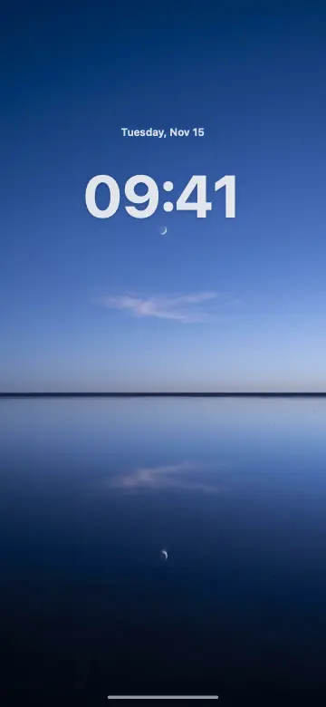
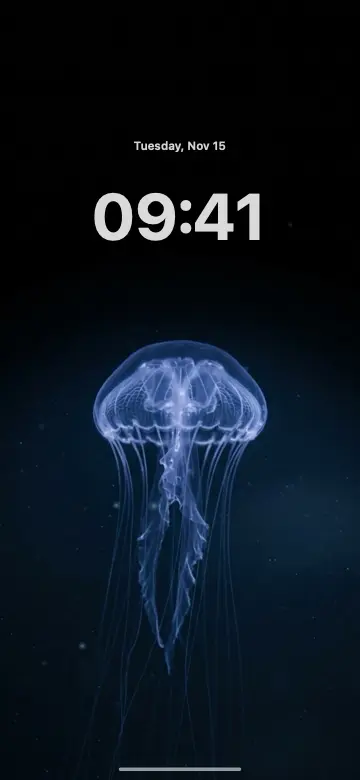
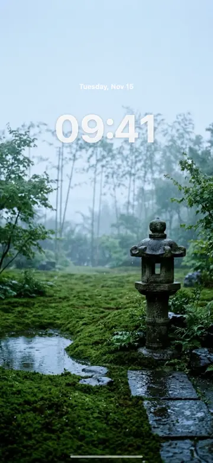
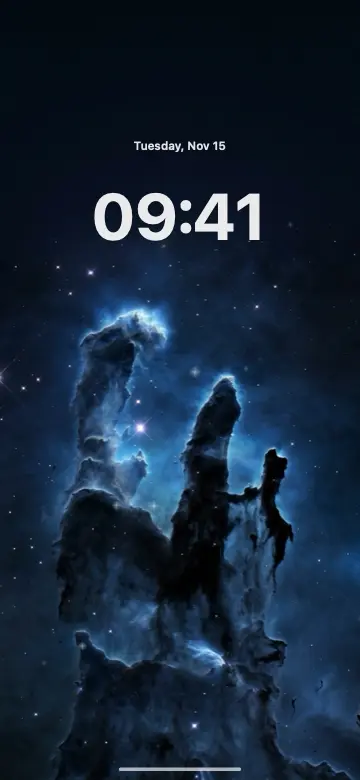
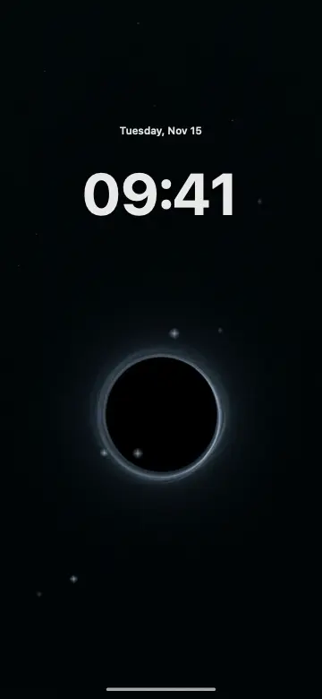
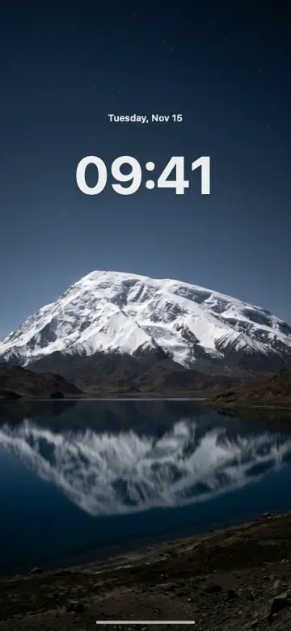
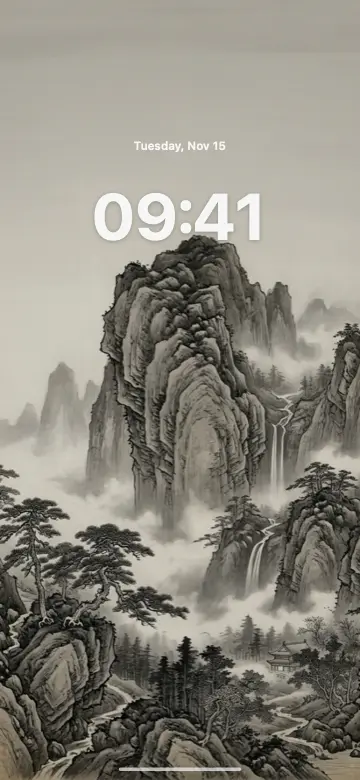
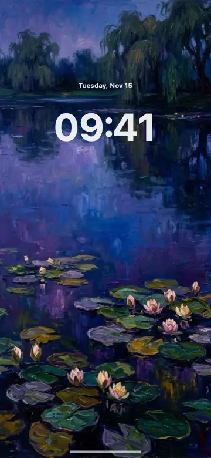
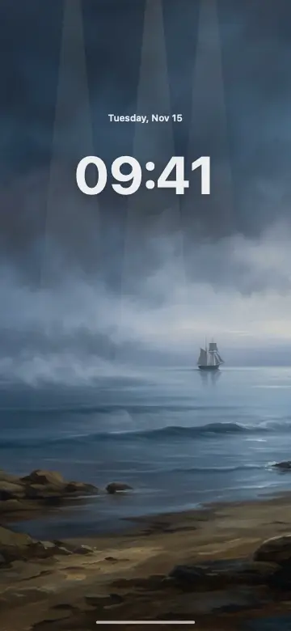
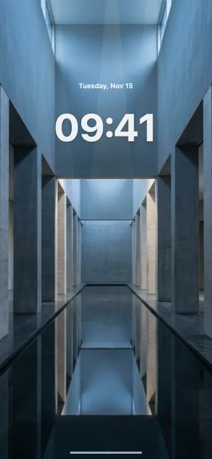

# Camlo Cloud `.tendies` Wallpaper Repository / 云端官方壁纸仓库

> Total packages / 收录包数: **20** · Total size (hosted outside IPA) / 仓库总体积（不占 IPA 安装包体积）: **31.43 MB**

These `.tendies` wallpaper packs are stored outside `Camlo/` so they add **0 bytes** to `Camlo.ipa` while remaining one-tap browsable and downloadable inside the Camlo **Cloud `.tendies` Gallery** (with automatic `ghfast.top` Mainland China mirror & GitHub Direct routing and SHA-256 verification).

本目录的 `.tendies` 壁纸包独立托管于仓库根目录 `wallpapers/` 下，**不会打入 `Camlo.ipa` 安装包**。在 App 内打开「**官方云端 `.tendies` 壁纸库**」即可支持大陆镜像加速在线预览、SHA-256 校验下载并一键写入锁屏或存入本地金库；也可以直接下载后通过 AirDrop / 文件导入。

| Preview | Name / 名称 | Category / 分类 | Depth / Features | Size | Direct Download (GitHub / CN Mirror) | SHA-256 (Prefix) |
| :---: | :--- | :---: | :---: | :---: | :--- | :--- |
|  | **罗弗敦 · 极夜孤屿** Lofoten · Arctic Silence | `Motion Loop` | 8 FPS Seamless | `2.93 MB` | [GitHub Raw](https://raw.githubusercontent.com/Kianuni/Camlo/main/wallpapers/packages/lofoten_arctic_silence.tendies) · [大陆镜像](https://ghfast.top/https://raw.githubusercontent.com/Kianuni/Camlo/main/wallpapers/packages/lofoten_arctic_silence.tendies) | `7dac14516ac0…` |
|  | **乌尤尼 · 苍穹之镜** Uyuni · Mirror of Eternity | `Motion Loop` | 8 FPS Seamless | `1.49 MB` | [GitHub Raw](https://raw.githubusercontent.com/Kianuni/Camlo/main/wallpapers/packages/uyuni_mirror_eternity.tendies) · [大陆镜像](https://ghfast.top/https://raw.githubusercontent.com/Kianuni/Camlo/main/wallpapers/packages/uyuni_mirror_eternity.tendies) | `42133018cbe5…` |
|  | **冥海浮生 · 幽蓝水母** Abyssal · Pelagic Grace | `Motion Loop` | 8 FPS Seamless | `1.75 MB` | [GitHub Raw](https://raw.githubusercontent.com/Kianuni/Camlo/main/wallpapers/packages/abyssal_pelagic_medusa.tendies) · [大陆镜像](https://ghfast.top/https://raw.githubusercontent.com/Kianuni/Camlo/main/wallpapers/packages/abyssal_pelagic_medusa.tendies) | `06684fc364bd…` |
|  | **苔庭听雨 · 幽篁微澜** Kyoto · Moss Garden Rain | `Motion Loop` | 8 FPS Seamless | `3.75 MB` | [GitHub Raw](https://raw.githubusercontent.com/Kianuni/Camlo/main/wallpapers/packages/kyoto_moss_rain_zen.tendies) · [大陆镜像](https://ghfast.top/https://raw.githubusercontent.com/Kianuni/Camlo/main/wallpapers/packages/kyoto_moss_rain_zen.tendies) | `71668eec6b5a…` |
|  | **黑曜流金 · 光影潮汐** Obsidian · Liquid Chiaroscuro | `Motion Loop` | 8 FPS Seamless | `2.15 MB` | [GitHub Raw](https://raw.githubusercontent.com/Kianuni/Camlo/main/wallpapers/packages/obsidian_champagne_tide.tendies) · [大陆镜像](https://ghfast.top/https://raw.githubusercontent.com/Kianuni/Camlo/main/wallpapers/packages/obsidian_champagne_tide.tendies) | `f7fcecf45846…` |
|  | **创生之柱 · 星尘破晓** Pillars of Creation · Stellar Dawn | `Cosmic Depth` | 14 FPS Seamless | `932 KB` | [GitHub Raw](https://raw.githubusercontent.com/Kianuni/Camlo/main/wallpapers/packages/pillars_of_creation_dawn.tendies) · [大陆镜像](https://ghfast.top/https://raw.githubusercontent.com/Kianuni/Camlo/main/wallpapers/packages/pillars_of_creation_dawn.tendies) | `fd5a7ef6a28d…` |
|  | **视界孤光 · 引力诗篇** Event Horizon · Relativistic Halo | `Cosmic Morph` | 14 FPS Seamless | `629 KB` | [GitHub Raw](https://raw.githubusercontent.com/Kianuni/Camlo/main/wallpapers/packages/event_horizon_poem.tendies) · [大陆镜像](https://ghfast.top/https://raw.githubusercontent.com/Kianuni/Camlo/main/wallpapers/packages/event_horizon_poem.tendies) | `a9b298fcbd93…` |
|  | **土星春分 · 环影日食** Saturn · Equinox Eclipse | `Cosmic Depth` | Clock Depth · CAML | `1.57 MB` | [GitHub Raw](https://raw.githubusercontent.com/Kianuni/Camlo/main/wallpapers/packages/saturn_equinox_eclipse.tendies) · [大陆镜像](https://ghfast.top/https://raw.githubusercontent.com/Kianuni/Camlo/main/wallpapers/packages/saturn_equinox_eclipse.tendies) | `e5e44405b69a…` |
|  | **静海孤月 · 蓝色弹珠** Sea of Tranquility · Earthrise | `Cosmic Depth` | 14 FPS Seamless | `1.36 MB` | [GitHub Raw](https://raw.githubusercontent.com/Kianuni/Camlo/main/wallpapers/packages/tranquility_earthrise.tendies) · [大陆镜像](https://ghfast.top/https://raw.githubusercontent.com/Kianuni/Camlo/main/wallpapers/packages/tranquility_earthrise.tendies) | `1f289c6f050a…` |
|  | **荒原星拱 · 仙女座之夜** Sandstone Arch · Andromeda Night | `Night Depth` | Clock Depth · CAML | `2.60 MB` | [GitHub Raw](https://raw.githubusercontent.com/Kianuni/Camlo/main/wallpapers/packages/desert_arch_andromeda.tendies) · [大陆镜像](https://ghfast.top/https://raw.githubusercontent.com/Kianuni/Camlo/main/wallpapers/packages/desert_arch_andromeda.tendies) | `008001d88e49…` |
|  | **巴塔哥尼亚 · 荒原燃金** Patagonia · Fitz Roy Alpenglow | `Nature Depth` | 14 FPS Seamless | `1.22 MB` | [GitHub Raw](https://raw.githubusercontent.com/Kianuni/Camlo/main/wallpapers/packages/patagonia_fitz_roy_fire.tendies) · [大陆镜像](https://ghfast.top/https://raw.githubusercontent.com/Kianuni/Camlo/main/wallpapers/packages/patagonia_fitz_roy_fire.tendies) | `e87e9cb0601c…` |
|  | **贝加尔湖 · 冰封深渊** Lake Baikal · Sapphire Ice Rifts | `Nature Morph` | 14 FPS Seamless | `1.21 MB` | [GitHub Raw](https://raw.githubusercontent.com/Kianuni/Camlo/main/wallpapers/packages/baikal_crystalline_abyss.tendies) · [大陆镜像](https://ghfast.top/https://raw.githubusercontent.com/Kianuni/Camlo/main/wallpapers/packages/baikal_crystalline_abyss.tendies) | `101e2e7491e8…` |
|  | **迷雾孤柏 · 静水微光** Misty Cypress · Still Water | `Fine-Art Depth` | 14 FPS Seamless | `1.03 MB` | [GitHub Raw](https://raw.githubusercontent.com/Kianuni/Camlo/main/wallpapers/packages/misty_cypress_stillness.tendies) · [大陆镜像](https://ghfast.top/https://raw.githubusercontent.com/Kianuni/Camlo/main/wallpapers/packages/misty_cypress_stillness.tendies) | `a515de1db4ec…` |
|  | **帕米尔 · 慕士塔格月华** Pamir · Moonlit Glaciers | `Nature Depth` | 14 FPS Seamless | `1.15 MB` | [GitHub Raw](https://raw.githubusercontent.com/Kianuni/Camlo/main/wallpapers/packages/pamir_moonlit_karakul.tendies) · [大陆镜像](https://ghfast.top/https://raw.githubusercontent.com/Kianuni/Camlo/main/wallpapers/packages/pamir_moonlit_karakul.tendies) | `54b65bc68bba…` |
|  | **千里江山 · 溪山霁雪** Song Scroll · Azurite Dawn | `Song Painting` | 14 FPS Seamless | `1.77 MB` | [GitHub Raw](https://raw.githubusercontent.com/Kianuni/Camlo/main/wallpapers/packages/song_qianli_qinglv.tendies) · [大陆镜像](https://ghfast.top/https://raw.githubusercontent.com/Kianuni/Camlo/main/wallpapers/packages/song_qianli_qinglv.tendies) | `f6a84f8cdc9c…` |
|  | **敦煌月牙 · 大漠星河** Dunhuang · Crescent Oasis | `Silk Road Depth` | 14 FPS Seamless | `1.02 MB` | [GitHub Raw](https://raw.githubusercontent.com/Kianuni/Camlo/main/wallpapers/packages/dunhuang_crescent_star.tendies) · [大陆镜像](https://ghfast.top/https://raw.githubusercontent.com/Kianuni/Camlo/main/wallpapers/packages/dunhuang_crescent_star.tendies) | `94b02dc002f6…` |
|  | **吉维尼 · 睡莲晨曦** Giverny · Nymphéas Light | `Impressionism` | 14 FPS Seamless | `1.86 MB` | [GitHub Raw](https://raw.githubusercontent.com/Kianuni/Camlo/main/wallpapers/packages/giverny_waterlilies_light.tendies) · [大陆镜像](https://ghfast.top/https://raw.githubusercontent.com/Kianuni/Camlo/main/wallpapers/packages/giverny_waterlilies_light.tendies) | `d7fbeb8eeefa…` |
|  | **雾海流霞 · 浪漫主义** Misty Sea · Romantic Sublime | `Romantic Oil` | 14 FPS Seamless | `1018 KB` | [GitHub Raw](https://raw.githubusercontent.com/Kianuni/Camlo/main/wallpapers/packages/turner_golden_seascape.tendies) · [大陆镜像](https://ghfast.top/https://raw.githubusercontent.com/Kianuni/Camlo/main/wallpapers/packages/turner_golden_seascape.tendies) | `52e797deed81…` |
|  | **苍穹之窗 · 暮光冥想** Skyspace · Oculus Meditation | `Light & Space` | 14 FPS Seamless | `1022 KB` | [GitHub Raw](https://raw.githubusercontent.com/Kianuni/Camlo/main/wallpapers/packages/skyspace_oculus_twilight.tendies) · [大陆镜像](https://ghfast.top/https://raw.githubusercontent.com/Kianuni/Camlo/main/wallpapers/packages/skyspace_oculus_twilight.tendies) | `3dd1ad2ea98d…` |
|  | **光之圣殿 · 静默几何** Sanctuary · Travertine Sunbeam | `Spatial Depth` | 14 FPS Seamless | `1.06 MB` | [GitHub Raw](https://raw.githubusercontent.com/Kianuni/Camlo/main/wallpapers/packages/pantheon_sunbeam_sanctuary.tendies) · [大陆镜像](https://ghfast.top/https://raw.githubusercontent.com/Kianuni/Camlo/main/wallpapers/packages/pantheon_sunbeam_sanctuary.tendies) | `a93060fc04d3…` |
