# Camlo Cloud `.tendies` Wallpaper Repository / 云端官方壁纸仓库

> Total packages / 收录包数: **60** · Total size (hosted outside IPA) / 仓库总体积（不占 IPA 安装包体积）: **128.30 MB**

These `.tendies` wallpaper packs are stored outside `Camlo/` so they add **0 bytes** to `Camlo.ipa` while remaining one-tap browsable and downloadable inside the Camlo **Cloud `.tendies` Gallery** (with automatic `ghfast.top` Mainland China mirror & GitHub Direct routing and SHA-256 verification).

本目录的 `.tendies` 壁纸包独立托管于仓库根目录 `wallpapers/` 下，**不会打入 `Camlo.ipa` 安装包**。在 App 内打开「**官方云端 `.tendies` 壁纸库**」即可支持大陆镜像加速在线预览、SHA-256 校验下载并一键写入锁屏或存入本地金库；也可以直接下载后通过 AirDrop / 文件导入。

| Preview | Name / 名称 | Category / 分类 | Depth / Features | Size | Direct Download (GitHub / CN Mirror) | SHA-256 (Prefix) |
| :---: | :--- | :---: | :---: | :---: | :--- | :--- |
|  | **沉思琴者 · 暗金厚涂** The Cellist · Chiaroscuro Reverie | `Old Master` | Clock Depth · CAML | `2.90 MB` | [GitHub Raw](https://raw.githubusercontent.com/Kianuni/Camlo/main/wallpapers/packages/rembrandt_cellist_reverie.tendies) · [大陆镜像](https://ghfast.top/https://raw.githubusercontent.com/Kianuni/Camlo/main/wallpapers/packages/rembrandt_cellist_reverie.tendies) | `f46c821ddfbf…` |
|  | **代尔夫特 · 珠光静室** Delft Window · Pearl Quietude | `Dutch Master` | Clock Depth · CAML | `2.25 MB` | [GitHub Raw](https://raw.githubusercontent.com/Kianuni/Camlo/main/wallpapers/packages/vermeer_window_letter.tendies) · [大陆镜像](https://ghfast.top/https://raw.githubusercontent.com/Kianuni/Camlo/main/wallpapers/packages/vermeer_window_letter.tendies) | `761d4c79ff51…` |
| 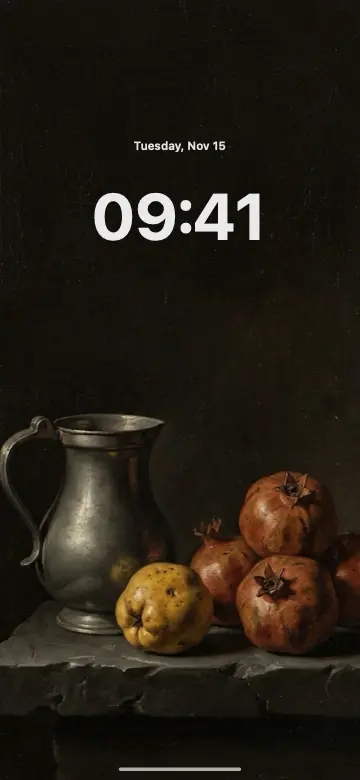 | **卡拉瓦乔 · 暗夜石榴** Caravaggio · Tenebrist Still Life | `Tenebrism` | Clock Depth · CAML | `2.33 MB` | [GitHub Raw](https://raw.githubusercontent.com/Kianuni/Camlo/main/wallpapers/packages/caravaggio_pomegranate_vanitas.tendies) · [大陆镜像](https://ghfast.top/https://raw.githubusercontent.com/Kianuni/Camlo/main/wallpapers/packages/caravaggio_pomegranate_vanitas.tendies) | `09923c5008e9…` |
|  | **拉图尔 · 烛影守夜** De La Tour · Candlelight Vigil | `Living Oil` | 8 FPS Seamless | `2.84 MB` | [GitHub Raw](https://raw.githubusercontent.com/Kianuni/Camlo/main/wallpapers/packages/latour_candlelight_vigil.tendies) · [大陆镜像](https://ghfast.top/https://raw.githubusercontent.com/Kianuni/Camlo/main/wallpapers/packages/latour_candlelight_vigil.tendies) | `696254c1cdd7…` |
|  | **威尼斯水巷 · 萨金特笔意** Venetian Canal · Bravura Nocturne | `Bravura Oil` | Slide Morph · CAML | `1.45 MB` | [GitHub Raw](https://raw.githubusercontent.com/Kianuni/Camlo/main/wallpapers/packages/sargent_venetian_gondola.tendies) · [大陆镜像](https://ghfast.top/https://raw.githubusercontent.com/Kianuni/Camlo/main/wallpapers/packages/sargent_venetian_gondola.tendies) | `6d0ee4320cef…` |
|  | **马德里画室 · 银灰空气** Madrid Atelier · Silver Velatura | `Spanish Master` | Slide Morph · CAML | `1.22 MB` | [GitHub Raw](https://raw.githubusercontent.com/Kianuni/Camlo/main/wallpapers/packages/velazquez_atelier_easel.tendies) · [大陆镜像](https://ghfast.top/https://raw.githubusercontent.com/Kianuni/Camlo/main/wallpapers/packages/velazquez_atelier_easel.tendies) | `e05e3e59c4b9…` |
| 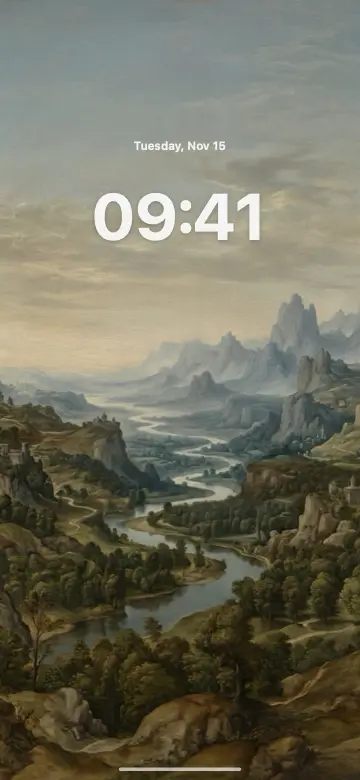 | **达芬奇晕涂 · 远山暮霭** Renaissance Valley · Sfumato Mist | `Renaissance` | Slide Morph · CAML | `1.33 MB` | [GitHub Raw](https://raw.githubusercontent.com/Kianuni/Camlo/main/wallpapers/packages/leonardo_sfumato_valley.tendies) · [大陆镜像](https://ghfast.top/https://raw.githubusercontent.com/Kianuni/Camlo/main/wallpapers/packages/leonardo_sfumato_valley.tendies) | `bd94765f05cc…` |
|  | **海岸橄榄园 · 外光碎金** Coastal Garden · Plein-Air Dusk | `Plein Air` | Slide Morph · CAML | `2.01 MB` | [GitHub Raw](https://raw.githubusercontent.com/Kianuni/Camlo/main/wallpapers/packages/sorolla_coastal_garden_dusk.tendies) · [大陆镜像](https://ghfast.top/https://raw.githubusercontent.com/Kianuni/Camlo/main/wallpapers/packages/sorolla_coastal_garden_dusk.tendies) | `e6887950b98d…` |
| 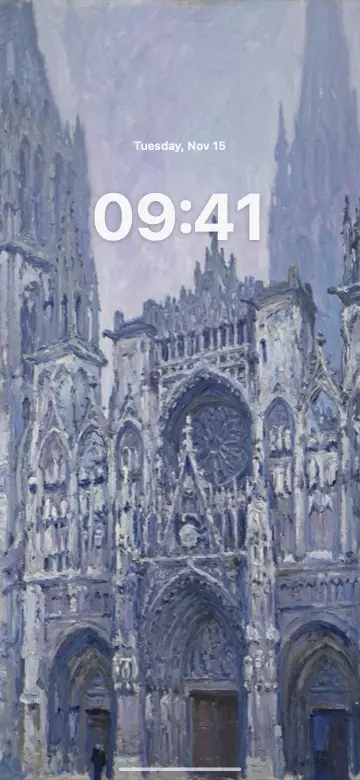 | **鲁昂石壁 · 晨昏色阶** Rouen Façade · Chromatic Crust | `Impressionism` | Slide Morph · CAML | `1.99 MB` | [GitHub Raw](https://raw.githubusercontent.com/Kianuni/Camlo/main/wallpapers/packages/monet_rouen_cathedral_light.tendies) · [大陆镜像](https://ghfast.top/https://raw.githubusercontent.com/Kianuni/Camlo/main/wallpapers/packages/monet_rouen_cathedral_light.tendies) | `2793626eaeb4…` |
|  | **圣雷米丝柏 · 旋涡星夜** Saint-Rémy · Impasto Cypress | `Living Impasto` | 8 FPS Seamless | `5.10 MB` | [GitHub Raw](https://raw.githubusercontent.com/Kianuni/Camlo/main/wallpapers/packages/vangogh_cypress_wheatfield.tendies) · [大陆镜像](https://ghfast.top/https://raw.githubusercontent.com/Kianuni/Camlo/main/wallpapers/packages/vangogh_cypress_wheatfield.tendies) | `bd982863a695…` |
| 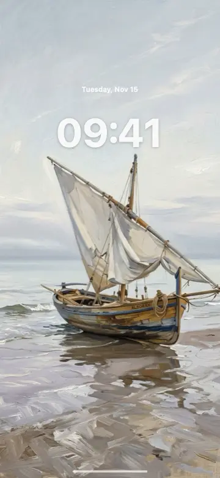 | **瓦伦西亚 · 逆光白帆** Valencia Surf · Luminous Sail | `Luminism` | Slide Morph · CAML | `1.57 MB` | [GitHub Raw](https://raw.githubusercontent.com/Kianuni/Camlo/main/wallpapers/packages/sorolla_valencia_white_sail.tendies) · [大陆镜像](https://ghfast.top/https://raw.githubusercontent.com/Kianuni/Camlo/main/wallpapers/packages/sorolla_valencia_white_sail.tendies) | `304e336eb267…` |
|  | **枫丹白露 · 银桦诗意** Ville-d'Avray · Silver Corot | `Barbizon Oil` | Slide Morph · CAML | `1.57 MB` | [GitHub Raw](https://raw.githubusercontent.com/Kianuni/Camlo/main/wallpapers/packages/corot_silver_birch_pond.tendies) · [大陆镜像](https://ghfast.top/https://raw.githubusercontent.com/Kianuni/Camlo/main/wallpapers/packages/corot_silver_birch_pond.tendies) | `c7618e35d3fc…` |
| 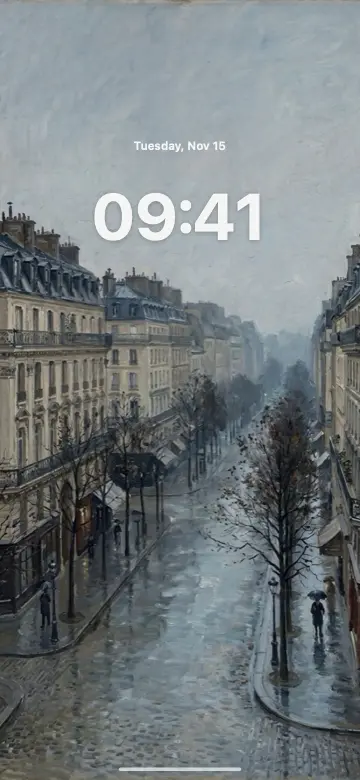 | **蒙马特雨暮 · 暖灯石街** Montmartre Rain · Oil Dusk | `Impressionism` | Slide Morph · CAML | `1.71 MB` | [GitHub Raw](https://raw.githubusercontent.com/Kianuni/Camlo/main/wallpapers/packages/pissarro_rainy_boulevard_lamp.tendies) · [大陆镜像](https://ghfast.top/https://raw.githubusercontent.com/Kianuni/Camlo/main/wallpapers/packages/pissarro_rainy_boulevard_lamp.tendies) | `49c1a626de9e…` |
| 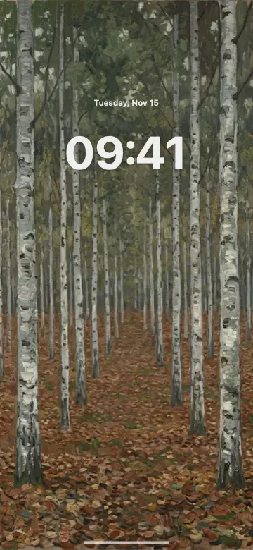 | **桦林秋毯 · 维也纳金叶** Attersee Woods · Gilded Moss | `Secession Gold` | Slide Morph · CAML | `2.22 MB` | [GitHub Raw](https://raw.githubusercontent.com/Kianuni/Camlo/main/wallpapers/packages/klimt_birch_forest_gold.tendies) · [大陆镜像](https://ghfast.top/https://raw.githubusercontent.com/Kianuni/Camlo/main/wallpapers/packages/klimt_birch_forest_gold.tendies) | `7d2e1cfdfe6d…` |
|  | **吕根白崖 · 崇高云海** Chalk Cliffs · Romantic Fog | `Romanticism` | Slide Morph · CAML | `1.15 MB` | [GitHub Raw](https://raw.githubusercontent.com/Kianuni/Camlo/main/wallpapers/packages/friedrich_wanderer_sea_fog.tendies) · [大陆镜像](https://ghfast.top/https://raw.githubusercontent.com/Kianuni/Camlo/main/wallpapers/packages/friedrich_wanderer_sea_fog.tendies) | `ad9296f770c6…` |
|  | **哥本哈根 · 静室斜阳** Strandgade · Silent Sunbeam | `Nordic Oil` | 8 FPS Seamless | `2.68 MB` | [GitHub Raw](https://raw.githubusercontent.com/Kianuni/Camlo/main/wallpapers/packages/hammershoi_dust_sunbeam_rooms.tendies) · [大陆镜像](https://ghfast.top/https://raw.githubusercontent.com/Kianuni/Camlo/main/wallpapers/packages/hammershoi_dust_sunbeam_rooms.tendies) | `321c72b11d8d…` |
| 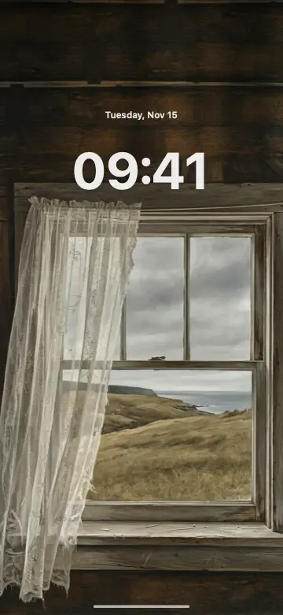 | **克里斯蒂娜之窗 · 蛋彩孤风** Maine Window · Egg Tempera | `Egg Tempera` | Slide Morph · CAML | `1.74 MB` | [GitHub Raw](https://raw.githubusercontent.com/Kianuni/Camlo/main/wallpapers/packages/wyeth_windblown_lace_window.tendies) · [大陆镜像](https://ghfast.top/https://raw.githubusercontent.com/Kianuni/Camlo/main/wallpapers/packages/wyeth_windblown_lace_window.tendies) | `657b60ec38a4…` |
| 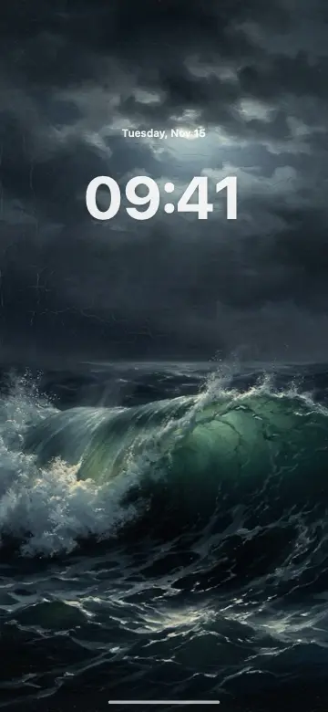 | **夜海琉璃 · 透光惊涛** Ninth Wave · Translucent Surge | `Marine Oil` | Slide Morph · CAML | `1.49 MB` | [GitHub Raw](https://raw.githubusercontent.com/Kianuni/Camlo/main/wallpapers/packages/aivazovsky_emerald_wave_moon.tendies) · [大陆镜像](https://ghfast.top/https://raw.githubusercontent.com/Kianuni/Camlo/main/wallpapers/packages/aivazovsky_emerald_wave_moon.tendies) | `da76c51dbe8b…` |
|  | **泰晤士夜曲 · 青金微星** Nocturne · Blue and Old Gold | `Nocturne Oil` | 8 FPS Seamless | `2.56 MB` | [GitHub Raw](https://raw.githubusercontent.com/Kianuni/Camlo/main/wallpapers/packages/whistler_thames_nocturne_gold.tendies) · [大陆镜像](https://ghfast.top/https://raw.githubusercontent.com/Kianuni/Camlo/main/wallpapers/packages/whistler_thames_nocturne_gold.tendies) | `06432d9042af…` |
| 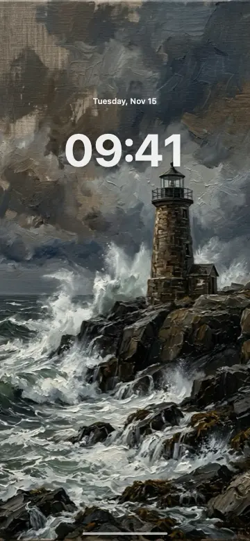 | **缅因礁岸 · 怒海孤灯** Maine Coast · Lighthouse Spray | `American Oil` | Slide Morph · CAML | `2.33 MB` | [GitHub Raw](https://raw.githubusercontent.com/Kianuni/Camlo/main/wallpapers/packages/homer_rockbound_lighthouse_spray.tendies) · [大陆镜像](https://ghfast.top/https://raw.githubusercontent.com/Kianuni/Camlo/main/wallpapers/packages/homer_rockbound_lighthouse_spray.tendies) | `d5d488e97cf3…` |
|  | **奥迪隆雷东 · 粉彩梦境** Odilon Redon · Pastel Reverie | `Pastel Art` | Clock Depth · CAML | `3.10 MB` | [GitHub Raw](https://raw.githubusercontent.com/Kianuni/Camlo/main/wallpapers/packages/redon_pastel_celestial_vase.tendies) · [大陆镜像](https://ghfast.top/https://raw.githubusercontent.com/Kianuni/Camlo/main/wallpapers/packages/redon_pastel_celestial_vase.tendies) | `621e0ec36b66…` |
|  | **秋江迷雾 · 马一角意境** Autumn River · Ma Yuan Silk | `Song Imperial` | Slide Morph · CAML | `1.56 MB` | [GitHub Raw](https://raw.githubusercontent.com/Kianuni/Camlo/main/wallpapers/packages/mayuan_autumn_river_boat.tendies) · [大陆镜像](https://ghfast.top/https://raw.githubusercontent.com/Kianuni/Camlo/main/wallpapers/packages/mayuan_autumn_river_boat.tendies) | `3aa1aab76a16…` |
|  | **早春烟岚 · 郭熙卷云皴** Early Spring · Guo Xi Scroll | `Living Scroll` | 8 FPS Seamless | `4.17 MB` | [GitHub Raw](https://raw.githubusercontent.com/Kianuni/Camlo/main/wallpapers/packages/guoxi_early_spring_jade_mist.tendies) · [大陆镜像](https://ghfast.top/https://raw.githubusercontent.com/Kianuni/Camlo/main/wallpapers/packages/guoxi_early_spring_jade_mist.tendies) | `5abde801a5de…` |
| 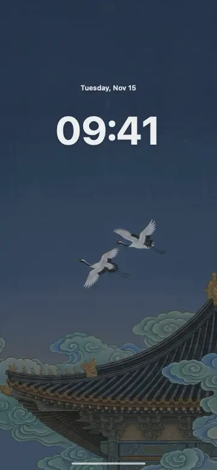 | **瑞鹤凌霄 · 宣和院体** Auspicious Cranes · Imperial Silk | `Imperial Gongbi` | Slide Morph · CAML | `1.32 MB` | [GitHub Raw](https://raw.githubusercontent.com/Kianuni/Camlo/main/wallpapers/packages/huizong_auspicious_cranes_palace.tendies) · [大陆镜像](https://ghfast.top/https://raw.githubusercontent.com/Kianuni/Camlo/main/wallpapers/packages/huizong_auspicious_cranes_palace.tendies) | `6b812b84ff4c…` |
| 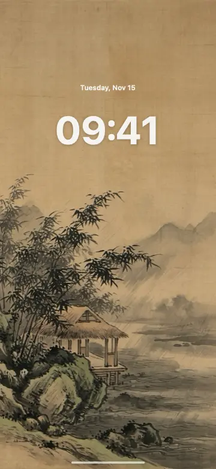 | **溪山霁雨 · 夏半边水墨** Misty Pavilion · Xia Gui Wash | `Song Ink` | Slide Morph · CAML | `1.72 MB` | [GitHub Raw](https://raw.githubusercontent.com/Kianuni/Camlo/main/wallpapers/packages/xiagui_wind_rain_bamboo_pavilion.tendies) · [大陆镜像](https://ghfast.top/https://raw.githubusercontent.com/Kianuni/Camlo/main/wallpapers/packages/xiagui_wind_rain_bamboo_pavilion.tendies) | `f205c09a73d3…` |
| 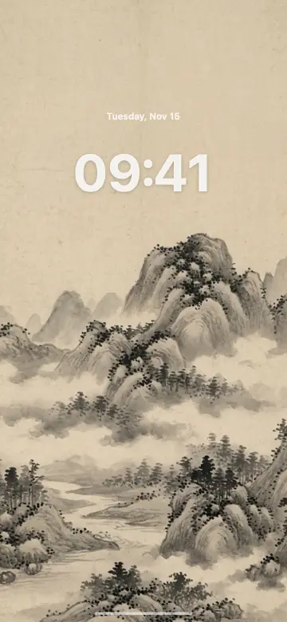 | **潇湘白云 · 米家水墨点** Cloudy Peaks · Mi Fu Ink Dots | `Literati Ink` | 8 FPS Seamless | `3.68 MB` | [GitHub Raw](https://raw.githubusercontent.com/Kianuni/Camlo/main/wallpapers/packages/mifu_cloudy_mountains_ink.tendies) · [大陆镜像](https://ghfast.top/https://raw.githubusercontent.com/Kianuni/Camlo/main/wallpapers/packages/mifu_cloudy_mountains_ink.tendies) | `cb1e11bdf374…` |
| 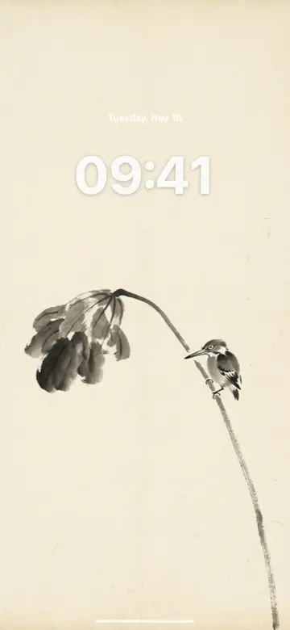 | **墨荷孤禽 · 八大禅意留白** Ink Lotus · Bada Shanren Zen | `Zen Xieyi` | Clock Depth · CAML | `1.44 MB` | [GitHub Raw](https://raw.githubusercontent.com/Kianuni/Camlo/main/wallpapers/packages/badashanren_lotus_kingfisher.tendies) · [大陆镜像](https://ghfast.top/https://raw.githubusercontent.com/Kianuni/Camlo/main/wallpapers/packages/badashanren_lotus_kingfisher.tendies) | `69b3a04aef60…` |
| 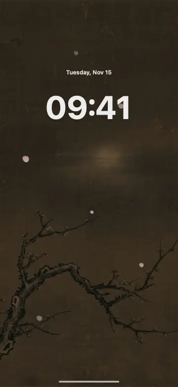 | **暗香疏影 · 宋绢寒梅月色** Moonlit Plum · Song Silk Branch | `Song Album` | Slide Morph · CAML | `1.32 MB` | [GitHub Raw](https://raw.githubusercontent.com/Kianuni/Camlo/main/wallpapers/packages/song_plum_blossom_moonlight.tendies) · [大陆镜像](https://ghfast.top/https://raw.githubusercontent.com/Kianuni/Camlo/main/wallpapers/packages/song_plum_blossom_moonlight.tendies) | `e1011f8f249b…` |
|  | **雪夜古刹 · 巴水木版拓印** Snowy Pagoda · Woodblock Night | `Shin-hanga` | Slide Morph · CAML | `2.04 MB` | [GitHub Raw](https://raw.githubusercontent.com/Kianuni/Camlo/main/wallpapers/packages/hasui_zojoji_red_pagoda_snow.tendies) · [大陆镜像](https://ghfast.top/https://raw.githubusercontent.com/Kianuni/Camlo/main/wallpapers/packages/hasui_zojoji_red_pagoda_snow.tendies) | `fc0ce97a7795…` |
|  | **甲州蓝摺 · 富岳苍松** Aizuri-e · Indigo Mount Fuji | `Ukiyo-e Print` | Slide Morph · CAML | `2.16 MB` | [GitHub Raw](https://raw.githubusercontent.com/Kianuni/Camlo/main/wallpapers/packages/hokusai_indigo_fuji_pine_coast.tendies) · [大陆镜像](https://ghfast.top/https://raw.githubusercontent.com/Kianuni/Camlo/main/wallpapers/packages/hokusai_indigo_fuji_pine_coast.tendies) | `72f75e75fe4c…` |
|  | **罗弗敦 · 极夜孤屿** Lofoten · Arctic Silence | `Motion Loop` | 8 FPS Seamless | `2.93 MB` | [GitHub Raw](https://raw.githubusercontent.com/Kianuni/Camlo/main/wallpapers/packages/lofoten_arctic_silence.tendies) · [大陆镜像](https://ghfast.top/https://raw.githubusercontent.com/Kianuni/Camlo/main/wallpapers/packages/lofoten_arctic_silence.tendies) | `7dac14516ac0…` |
|  | **乌尤尼 · 苍穹之镜** Uyuni · Mirror of Eternity | `Motion Loop` | 8 FPS Seamless | `1.49 MB` | [GitHub Raw](https://raw.githubusercontent.com/Kianuni/Camlo/main/wallpapers/packages/uyuni_mirror_eternity.tendies) · [大陆镜像](https://ghfast.top/https://raw.githubusercontent.com/Kianuni/Camlo/main/wallpapers/packages/uyuni_mirror_eternity.tendies) | `42133018cbe5…` |
|  | **冥海浮生 · 幽蓝水母** Abyssal · Pelagic Grace | `Motion Loop` | 8 FPS Seamless | `1.75 MB` | [GitHub Raw](https://raw.githubusercontent.com/Kianuni/Camlo/main/wallpapers/packages/abyssal_pelagic_medusa.tendies) · [大陆镜像](https://ghfast.top/https://raw.githubusercontent.com/Kianuni/Camlo/main/wallpapers/packages/abyssal_pelagic_medusa.tendies) | `06684fc364bd…` |
|  | **苔庭听雨 · 幽篁微澜** Kyoto · Moss Garden Rain | `Motion Loop` | 8 FPS Seamless | `3.75 MB` | [GitHub Raw](https://raw.githubusercontent.com/Kianuni/Camlo/main/wallpapers/packages/kyoto_moss_rain_zen.tendies) · [大陆镜像](https://ghfast.top/https://raw.githubusercontent.com/Kianuni/Camlo/main/wallpapers/packages/kyoto_moss_rain_zen.tendies) | `71668eec6b5a…` |
|  | **黑曜流金 · 光影潮汐** Obsidian · Liquid Chiaroscuro | `Motion Loop` | 8 FPS Seamless | `2.15 MB` | [GitHub Raw](https://raw.githubusercontent.com/Kianuni/Camlo/main/wallpapers/packages/obsidian_champagne_tide.tendies) · [大陆镜像](https://ghfast.top/https://raw.githubusercontent.com/Kianuni/Camlo/main/wallpapers/packages/obsidian_champagne_tide.tendies) | `f7fcecf45846…` |
|  | **创生之柱 · 星尘破晓** Pillars of Creation · Stellar Dawn | `Cosmic Depth` | Slide Morph · CAML | `932 KB` | [GitHub Raw](https://raw.githubusercontent.com/Kianuni/Camlo/main/wallpapers/packages/pillars_of_creation_dawn.tendies) · [大陆镜像](https://ghfast.top/https://raw.githubusercontent.com/Kianuni/Camlo/main/wallpapers/packages/pillars_of_creation_dawn.tendies) | `fd5a7ef6a28d…` |
|  | **视界孤光 · 引力诗篇** Event Horizon · Relativistic Halo | `Cosmic Morph` | Slide Morph · CAML | `629 KB` | [GitHub Raw](https://raw.githubusercontent.com/Kianuni/Camlo/main/wallpapers/packages/event_horizon_poem.tendies) · [大陆镜像](https://ghfast.top/https://raw.githubusercontent.com/Kianuni/Camlo/main/wallpapers/packages/event_horizon_poem.tendies) | `a9b298fcbd93…` |
| 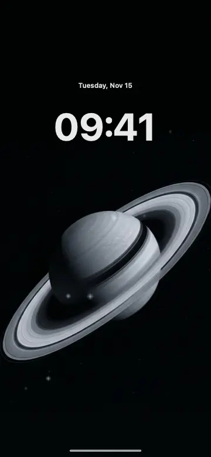 | **土星春分 · 环影日食** Saturn · Equinox Eclipse | `Cosmic Depth` | Clock Depth · CAML | `1.57 MB` | [GitHub Raw](https://raw.githubusercontent.com/Kianuni/Camlo/main/wallpapers/packages/saturn_equinox_eclipse.tendies) · [大陆镜像](https://ghfast.top/https://raw.githubusercontent.com/Kianuni/Camlo/main/wallpapers/packages/saturn_equinox_eclipse.tendies) | `e5e44405b69a…` |
|  | **静海孤月 · 蓝色弹珠** Sea of Tranquility · Earthrise | `Cosmic Depth` | Slide Morph · CAML | `1.36 MB` | [GitHub Raw](https://raw.githubusercontent.com/Kianuni/Camlo/main/wallpapers/packages/tranquility_earthrise.tendies) · [大陆镜像](https://ghfast.top/https://raw.githubusercontent.com/Kianuni/Camlo/main/wallpapers/packages/tranquility_earthrise.tendies) | `1f289c6f050a…` |
| 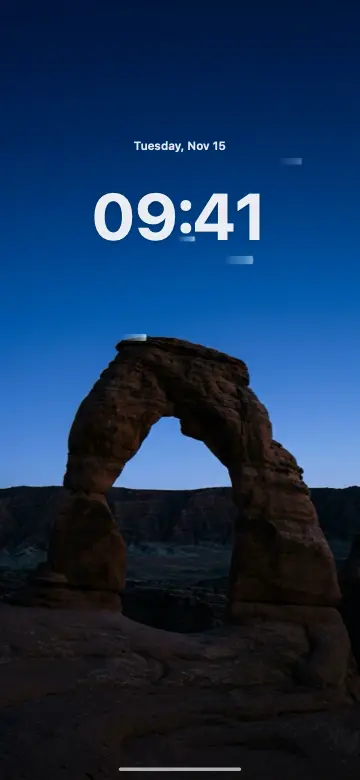 | **荒原星拱 · 仙女座之夜** Sandstone Arch · Andromeda Night | `Night Depth` | Clock Depth · CAML | `2.60 MB` | [GitHub Raw](https://raw.githubusercontent.com/Kianuni/Camlo/main/wallpapers/packages/desert_arch_andromeda.tendies) · [大陆镜像](https://ghfast.top/https://raw.githubusercontent.com/Kianuni/Camlo/main/wallpapers/packages/desert_arch_andromeda.tendies) | `008001d88e49…` |
|  | **巴塔哥尼亚 · 荒原燃金** Patagonia · Fitz Roy Alpenglow | `Nature Depth` | Slide Morph · CAML | `1.22 MB` | [GitHub Raw](https://raw.githubusercontent.com/Kianuni/Camlo/main/wallpapers/packages/patagonia_fitz_roy_fire.tendies) · [大陆镜像](https://ghfast.top/https://raw.githubusercontent.com/Kianuni/Camlo/main/wallpapers/packages/patagonia_fitz_roy_fire.tendies) | `e87e9cb0601c…` |
|  | **贝加尔湖 · 冰封深渊** Lake Baikal · Sapphire Ice Rifts | `Nature Morph` | Slide Morph · CAML | `1.21 MB` | [GitHub Raw](https://raw.githubusercontent.com/Kianuni/Camlo/main/wallpapers/packages/baikal_crystalline_abyss.tendies) · [大陆镜像](https://ghfast.top/https://raw.githubusercontent.com/Kianuni/Camlo/main/wallpapers/packages/baikal_crystalline_abyss.tendies) | `101e2e7491e8…` |
| 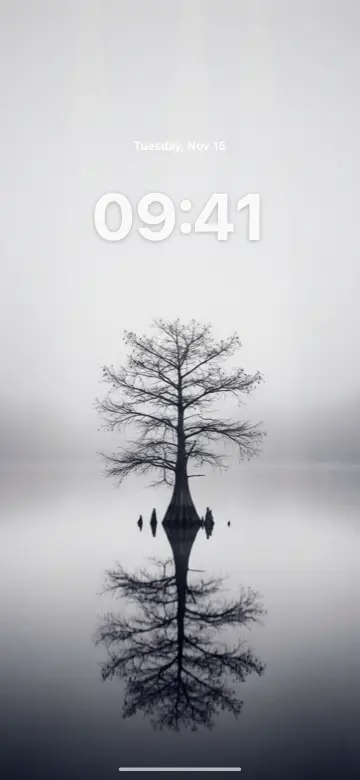 | **迷雾孤柏 · 静水微光** Misty Cypress · Still Water | `Fine-Art Depth` | Slide Morph · CAML | `1.03 MB` | [GitHub Raw](https://raw.githubusercontent.com/Kianuni/Camlo/main/wallpapers/packages/misty_cypress_stillness.tendies) · [大陆镜像](https://ghfast.top/https://raw.githubusercontent.com/Kianuni/Camlo/main/wallpapers/packages/misty_cypress_stillness.tendies) | `a515de1db4ec…` |
|  | **帕米尔 · 慕士塔格月华** Pamir · Moonlit Glaciers | `Nature Depth` | Slide Morph · CAML | `1.15 MB` | [GitHub Raw](https://raw.githubusercontent.com/Kianuni/Camlo/main/wallpapers/packages/pamir_moonlit_karakul.tendies) · [大陆镜像](https://ghfast.top/https://raw.githubusercontent.com/Kianuni/Camlo/main/wallpapers/packages/pamir_moonlit_karakul.tendies) | `54b65bc68bba…` |
|  | **千里江山 · 溪山霁雪** Song Scroll · Azurite Dawn | `Song Painting` | Slide Morph · CAML | `1.77 MB` | [GitHub Raw](https://raw.githubusercontent.com/Kianuni/Camlo/main/wallpapers/packages/song_qianli_qinglv.tendies) · [大陆镜像](https://ghfast.top/https://raw.githubusercontent.com/Kianuni/Camlo/main/wallpapers/packages/song_qianli_qinglv.tendies) | `f6a84f8cdc9c…` |
| 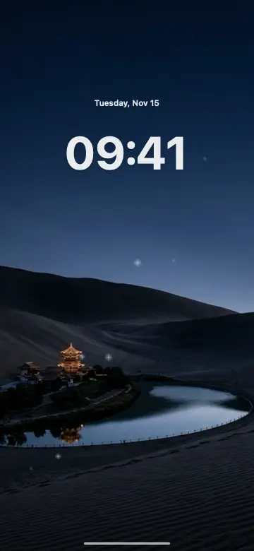 | **敦煌月牙 · 大漠星河** Dunhuang · Crescent Oasis | `Silk Road Depth` | Slide Morph · CAML | `1.02 MB` | [GitHub Raw](https://raw.githubusercontent.com/Kianuni/Camlo/main/wallpapers/packages/dunhuang_crescent_star.tendies) · [大陆镜像](https://ghfast.top/https://raw.githubusercontent.com/Kianuni/Camlo/main/wallpapers/packages/dunhuang_crescent_star.tendies) | `94b02dc002f6…` |
|  | **吉维尼 · 睡莲晨曦** Giverny · Nymphéas Light | `Impressionism` | Slide Morph · CAML | `1.86 MB` | [GitHub Raw](https://raw.githubusercontent.com/Kianuni/Camlo/main/wallpapers/packages/giverny_waterlilies_light.tendies) · [大陆镜像](https://ghfast.top/https://raw.githubusercontent.com/Kianuni/Camlo/main/wallpapers/packages/giverny_waterlilies_light.tendies) | `d7fbeb8eeefa…` |
|  | **雾海流霞 · 浪漫主义** Misty Sea · Romantic Sublime | `Romantic Oil` | Slide Morph · CAML | `1018 KB` | [GitHub Raw](https://raw.githubusercontent.com/Kianuni/Camlo/main/wallpapers/packages/turner_golden_seascape.tendies) · [大陆镜像](https://ghfast.top/https://raw.githubusercontent.com/Kianuni/Camlo/main/wallpapers/packages/turner_golden_seascape.tendies) | `52e797deed81…` |
| 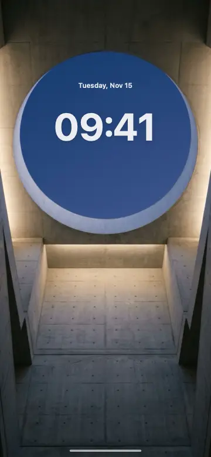 | **苍穹之窗 · 暮光冥想** Skyspace · Oculus Meditation | `Light & Space` | Slide Morph · CAML | `1022 KB` | [GitHub Raw](https://raw.githubusercontent.com/Kianuni/Camlo/main/wallpapers/packages/skyspace_oculus_twilight.tendies) · [大陆镜像](https://ghfast.top/https://raw.githubusercontent.com/Kianuni/Camlo/main/wallpapers/packages/skyspace_oculus_twilight.tendies) | `3dd1ad2ea98d…` |
|  | **光之圣殿 · 静默几何** Sanctuary · Travertine Sunbeam | `Spatial Depth` | Slide Morph · CAML | `1.06 MB` | [GitHub Raw](https://raw.githubusercontent.com/Kianuni/Camlo/main/wallpapers/packages/pantheon_sunbeam_sanctuary.tendies) · [大陆镜像](https://ghfast.top/https://raw.githubusercontent.com/Kianuni/Camlo/main/wallpapers/packages/pantheon_sunbeam_sanctuary.tendies) | `a93060fc04d3…` |
|  | **千里青绿 · 双屏长卷** Qianli Scroll · Dual Unfold | `Duo · Song Silk` | Duo Inner+Outer · 3D CAML | `3.04 MB` | [GitHub Raw](https://raw.githubusercontent.com/Kianuni/Camlo/main/wallpapers/packages/duo_qianli_handscroll_dawn.tendies) · [大陆镜像](https://ghfast.top/https://raw.githubusercontent.com/Kianuni/Camlo/main/wallpapers/packages/duo_qianli_handscroll_dawn.tendies) | `02cd22a39594…` |
| 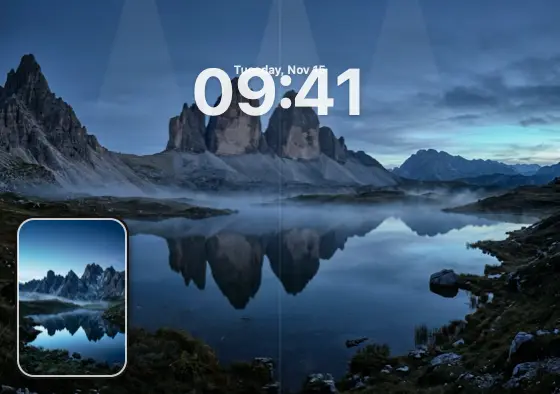 | **多洛米蒂 · 日照金山双屏** Dolomites · Alpenglow Panorama | `Duo · Alpine` | Duo Inner+Outer · 3D CAML | `2.11 MB` | [GitHub Raw](https://raw.githubusercontent.com/Kianuni/Camlo/main/wallpapers/packages/duo_dolomites_alpenglow_panorama.tendies) · [大陆镜像](https://ghfast.top/https://raw.githubusercontent.com/Kianuni/Camlo/main/wallpapers/packages/duo_dolomites_alpenglow_panorama.tendies) | `d15e5bb7d94f…` |
|  | **睡莲长卷 · 橘园晨光** Orangerie Lilies · Dual Mural | `Duo · Impressionism` | Duo Inner+Outer · 3D CAML | `3.47 MB` | [GitHub Raw](https://raw.githubusercontent.com/Kianuni/Camlo/main/wallpapers/packages/duo_monet_waterlily_triptych.tendies) · [大陆镜像](https://ghfast.top/https://raw.githubusercontent.com/Kianuni/Camlo/main/wallpapers/packages/duo_monet_waterlily_triptych.tendies) | `4f9af98e5ac9…` |
| 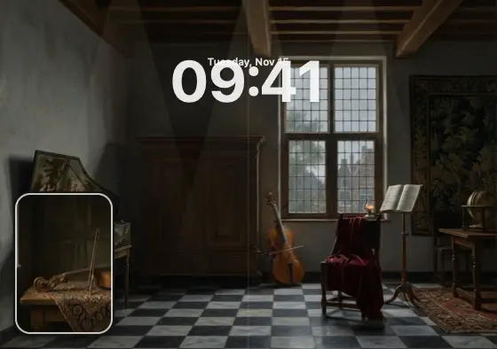 | **巴洛克琴室 · 明暗奏鸣** Baroque Chamber · Chiaroscuro | `Duo · Baroque` | Duo Inner+Outer · 3D CAML | `3.35 MB` | [GitHub Raw](https://raw.githubusercontent.com/Kianuni/Camlo/main/wallpapers/packages/duo_rembrandt_chamber_concert.tendies) · [大陆镜像](https://ghfast.top/https://raw.githubusercontent.com/Kianuni/Camlo/main/wallpapers/packages/duo_rembrandt_chamber_concert.tendies) | `1d650fd95f67…` |
| 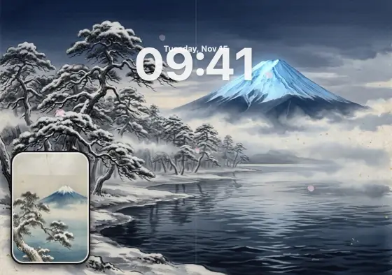 | **金箔松风 · 江户屏风** Kinpaku Byōbu · Pine & Red Fuji | `Duo · Byōbu` | Duo Inner+Outer · 3D CAML | `3.15 MB` | [GitHub Raw](https://raw.githubusercontent.com/Kianuni/Camlo/main/wallpapers/packages/duo_fuji_pine_screen_byobu.tendies) · [大陆镜像](https://ghfast.top/https://raw.githubusercontent.com/Kianuni/Camlo/main/wallpapers/packages/duo_fuji_pine_screen_byobu.tendies) | `7dbf38700b32…` |
| 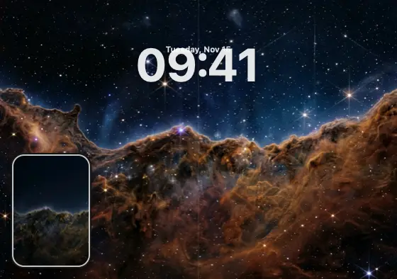 | **船底座星崖 · 深空巨幕** Carina Cliffs · Cosmic Wide | `Duo · Cosmos` | Duo Inner+Outer · 3D CAML | `2.15 MB` | [GitHub Raw](https://raw.githubusercontent.com/Kianuni/Camlo/main/wallpapers/packages/duo_carina_cosmic_cliffs_wide.tendies) · [大陆镜像](https://ghfast.top/https://raw.githubusercontent.com/Kianuni/Camlo/main/wallpapers/packages/duo_carina_cosmic_cliffs_wide.tendies) | `4fb7c42849d4…` |
| 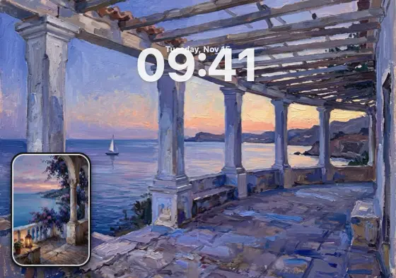 | **地中海柱廊 · 索罗亚日光** Mediterranean Terrace · Luminism | `Duo · Luminism` | Duo Inner+Outer · 3D CAML | `3.48 MB` | [GitHub Raw](https://raw.githubusercontent.com/Kianuni/Camlo/main/wallpapers/packages/duo_sorolla_mediterranean_terrace.tendies) · [大陆镜像](https://ghfast.top/https://raw.githubusercontent.com/Kianuni/Camlo/main/wallpapers/packages/duo_sorolla_mediterranean_terrace.tendies) | `9a6aff91a126…` |
|  | **纳米布星沙 · 破晓沙海** Namib Dune Sea · Starlit Dawn | `Duo · Desert` | Duo Inner+Outer · 3D CAML | `2.18 MB` | [GitHub Raw](https://raw.githubusercontent.com/Kianuni/Camlo/main/wallpapers/packages/duo_namib_starry_dune_sea.tendies) · [大陆镜像](https://ghfast.top/https://raw.githubusercontent.com/Kianuni/Camlo/main/wallpapers/packages/duo_namib_starry_dune_sea.tendies) | `7bc16c8bcd66…` |
|  | **郭熙烟岚 · 呼吸宋画** Guo Xi Valleys · Living Scroll | `Duo · Live Ink` | Duo Inner+Outer · Live 12 FPS | `5.02 MB` | [GitHub Raw](https://raw.githubusercontent.com/Kianuni/Camlo/main/wallpapers/packages/duo_guoxi_misty_valleys_scroll.tendies) · [大陆镜像](https://ghfast.top/https://raw.githubusercontent.com/Kianuni/Camlo/main/wallpapers/packages/duo_guoxi_misty_valleys_scroll.tendies) | `61dbc3f6f5b5…` |
| 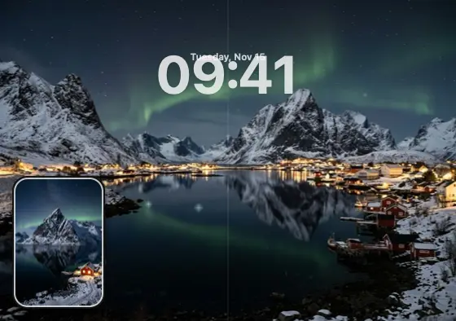 | **罗弗敦极光 · 峡湾实况长镜** Lofoten Aurora · Dual Fjord Live | `Duo · Live Aurora` | Duo Inner+Outer · Live 12 FPS | `3.96 MB` | [GitHub Raw](https://raw.githubusercontent.com/Kianuni/Camlo/main/wallpapers/packages/duo_lofoten_aurora_fjord_panorama.tendies) · [大陆镜像](https://ghfast.top/https://raw.githubusercontent.com/Kianuni/Camlo/main/wallpapers/packages/duo_lofoten_aurora_fjord_panorama.tendies) | `88a4330794f1…` |
