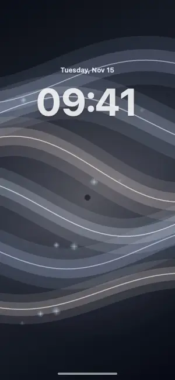
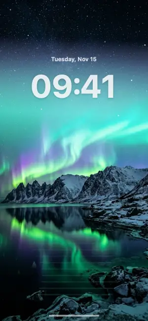
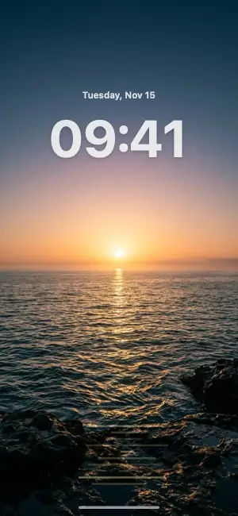
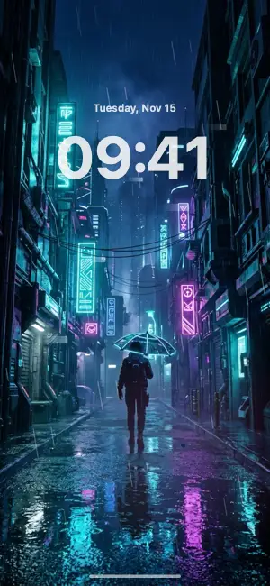
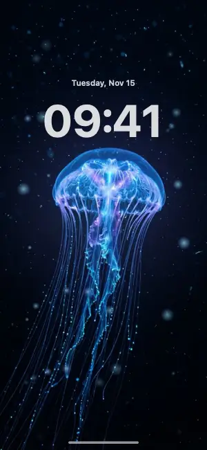
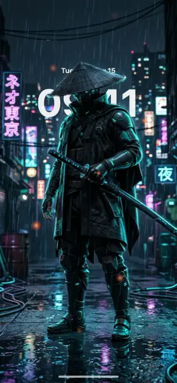
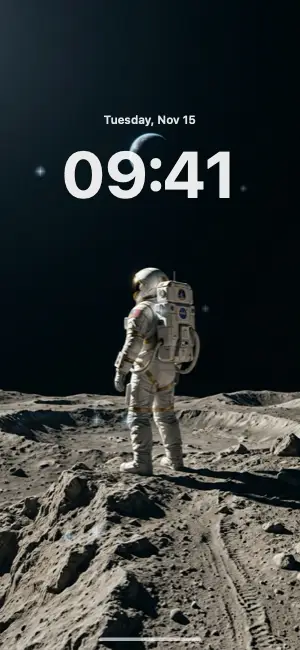
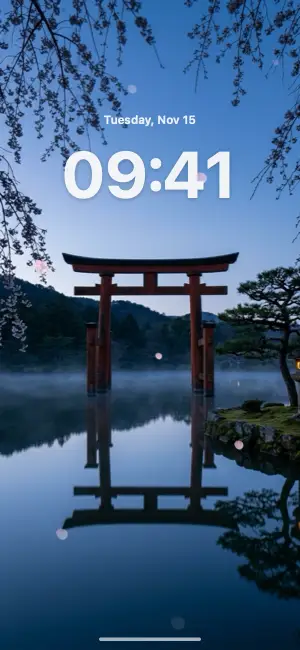
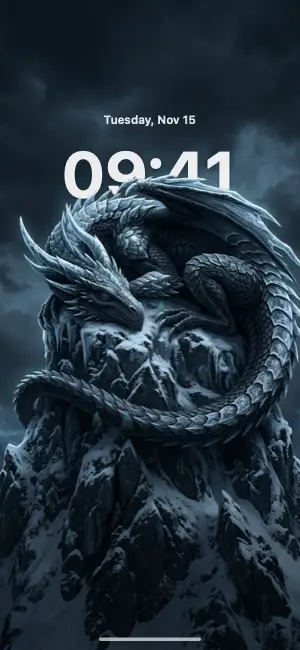

# Camlo Cloud `.tendies` Wallpaper Repository / 云端官方壁纸仓库

> Total packages / 收录包数: **10** · Total size (hosted outside IPA) / 仓库总体积（不占 IPA 安装包体积）: **24.34 MB**

These `.tendies` wallpaper packs are stored outside `Camlo/` so they add **0 bytes** to `Camlo.ipa` while remaining one-tap browsable and downloadable inside the Camlo **Cloud `.tendies` Gallery** (with automatic `ghfast.top` Mainland China mirror & GitHub Direct routing and SHA-256 verification).

本目录的 `.tendies` 壁纸包独立托管于仓库根目录 `wallpapers/` 下，**不会打入 `Camlo.ipa` 安装包**。在 App 内打开「**官方云端 `.tendies` 壁纸库**」即可支持大陆镜像加速在线预览、SHA-256 校验下载并一键写入锁屏或存入本地金库；也可以直接下载后通过 AirDrop / 文件导入。

| Preview | Name / 名称 | Category / 分类 | Depth / Features | Size | Direct Download (GitHub / CN Mirror) | SHA-256 (Prefix) |
| :---: | :--- | :---: | :---: | :---: | :--- | :--- |
|  | **钛金丝绸流体** Titanium Silk Flow | `Motion Loop` | 15 FPS Seamless | `915 KB` | [GitHub Raw](https://raw.githubusercontent.com/Kianuni/Camlo/main/wallpapers/packages/titanium_silk_flow.tendies) · [大陆镜像](https://ghfast.top/https://raw.githubusercontent.com/Kianuni/Camlo/main/wallpapers/packages/titanium_silk_flow.tendies) | `550ff26a57d6…` |
|  | **极光星瀑** Polar Aurora Curtain | `Motion Loop` | 14 FPS Seamless | `2.73 MB` | [GitHub Raw](https://raw.githubusercontent.com/Kianuni/Camlo/main/wallpapers/packages/polar_aurora_curtain.tendies) · [大陆镜像](https://ghfast.top/https://raw.githubusercontent.com/Kianuni/Camlo/main/wallpapers/packages/polar_aurora_curtain.tendies) | `ac3b1065869a…` |
|  | **落日海面金波** Golden Ocean Sunset | `Motion Loop` | 14 FPS Seamless | `2.38 MB` | [GitHub Raw](https://raw.githubusercontent.com/Kianuni/Camlo/main/wallpapers/packages/sunset_ocean_shimmer.tendies) · [大陆镜像](https://ghfast.top/https://raw.githubusercontent.com/Kianuni/Camlo/main/wallpapers/packages/sunset_ocean_shimmer.tendies) | `12171a776460…` |
|  | **赛博霓虹雨夜** Cyber Neon Rain | `Motion Loop` | 15 FPS Seamless | `3.62 MB` | [GitHub Raw](https://raw.githubusercontent.com/Kianuni/Camlo/main/wallpapers/packages/cyber_neon_rain.tendies) · [大陆镜像](https://ghfast.top/https://raw.githubusercontent.com/Kianuni/Camlo/main/wallpapers/packages/cyber_neon_rain.tendies) | `3da3f01122a3…` |
|  | **深海荧光水母** Abyssal Glow Jellyfish | `Motion Loop` | 14 FPS Seamless | `1.96 MB` | [GitHub Raw](https://raw.githubusercontent.com/Kianuni/Camlo/main/wallpapers/packages/abyssal_jellyfish_glow.tendies) · [大陆镜像](https://ghfast.top/https://raw.githubusercontent.com/Kianuni/Camlo/main/wallpapers/packages/abyssal_jellyfish_glow.tendies) | `9ee698024cde…` |
|  | **霓虹浪人·拔刀** Neon Ronin Slash | `Depth Morph` | Clock Depth · CAML | `3.40 MB` | [GitHub Raw](https://raw.githubusercontent.com/Kianuni/Camlo/main/wallpapers/packages/neon_ronin_slash.tendies) · [大陆镜像](https://ghfast.top/https://raw.githubusercontent.com/Kianuni/Camlo/main/wallpapers/packages/neon_ronin_slash.tendies) | `7cb7f5b3a32a…` |
|  | **月面地出星门** Lunar Earthrise Portal | `Depth Morph` | Clock Depth · CAML | `2.16 MB` | [GitHub Raw](https://raw.githubusercontent.com/Kianuni/Camlo/main/wallpapers/packages/lunar_earthrise_portal.tendies) · [大陆镜像](https://ghfast.top/https://raw.githubusercontent.com/Kianuni/Camlo/main/wallpapers/packages/lunar_earthrise_portal.tendies) | `95a3924b0cdb…` |
|  | **京都樱吹雪** Kyoto Sakura Dawn | `Depth Morph` | Clock Depth · CAML | `1.72 MB` | [GitHub Raw](https://raw.githubusercontent.com/Kianuni/Camlo/main/wallpapers/packages/kyoto_sakura_dawn.tendies) · [大陆镜像](https://ghfast.top/https://raw.githubusercontent.com/Kianuni/Camlo/main/wallpapers/packages/kyoto_sakura_dawn.tendies) | `0ee5f12129a0…` |
|  | **冰霜巨龙觉醒** Frost Dragon Awaken | `Depth Morph` | Clock Depth · CAML | `4.08 MB` | [GitHub Raw](https://raw.githubusercontent.com/Kianuni/Camlo/main/wallpapers/packages/frost_dragon_awaken.tendies) · [大陆镜像](https://ghfast.top/https://raw.githubusercontent.com/Kianuni/Camlo/main/wallpapers/packages/frost_dragon_awaken.tendies) | `e217fb950f26…` |
|  | **银翼超跑脉冲** Silver GT Apex | `Depth Morph` | Clock Depth · CAML | `1.40 MB` | [GitHub Raw](https://raw.githubusercontent.com/Kianuni/Camlo/main/wallpapers/packages/silver_gt_apex.tendies) · [大陆镜像](https://ghfast.top/https://raw.githubusercontent.com/Kianuni/Camlo/main/wallpapers/packages/silver_gt_apex.tendies) | `dad5122fb05c…` |
